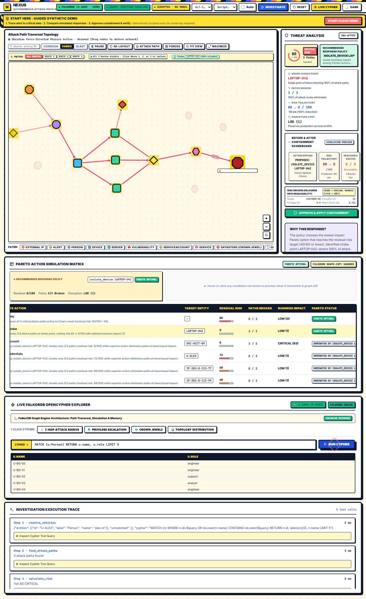
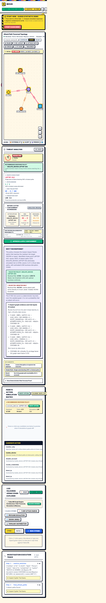
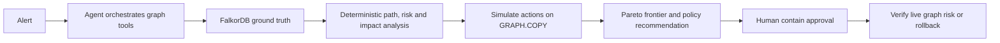

# NEXUS

**SYNTHETIC DATA** — NEXUS traces alert-linked identities through FalkorDB attack paths, simulates responses on disposable graph copies, and recommends a response under a visible risk-versus-disruption policy.

An alert can look small while the affected identity can reach critical data through several systems. The safest response is not always the action that removes the most risk: disabling a shared service account can interrupt production. NEXUS shows the paths and action trade-offs before a human approves containment.

## Demo

- Browser screenshots: [desktop investigation](artifacts/screenshots/nexus-investigation-desktop.png) · [live cypher repl & sandbox diff](artifacts/screenshots/nexus-cypher-repl-sandbox-diff.png) · [mobile investigation](artifacts/screenshots/nexus-investigation-mobile.png).
- Video: pending recording.
- **Judge & Evaluator Guide**: See [docs/falkordb-architecture.md](docs/falkordb-architecture.md) for complete schema, Cypher queries, and demonstrable verification flows.

## 1-Minute Judge Demo Walkthrough (Start to Finish)

Experience the full autonomous graph SOC investigation in 60 seconds:

1. **Start Clean Demo**:
   - Check the header pill: `● Graph: Pristine Baseline` confirms a clean FalkorDB database.
   - Click the green **Start clean demo** button (top-right). NEXUS instantly loads alert `ALT-1042` (`IMPOSSIBLE_TRAVEL`), verifies baseline state, and runs deterministic graph path resolution.

2. **Inspect the 3 Attack Paths & Crown Jewel**:
   - In the **Paths Subway Bar**, switch between `All Routes`, `Route 1`, `Route 2`, and `Route 3`.
   - Notice that all 3 routes travel from compromised engineer `U-ALEX` -> `LAPTOP-042` -> lateral jump servers -> `SVC-ACCT-09` -> `PROD-API` -> terminal Crown Jewel `👑 CUSTOMER-DB [CROWN JEWEL]`.
   - On the interactive Cytoscape graph canvas, observe `CUSTOMER-DB` highlighted as a radiant gold octagon.

3. **Inspect the Evidence & Real-World SOC Trade-Off**:
   - **Choke Point Identified**: `LAPTOP-042` blocks 100% of attack paths (3 of 3 routes).
   - **Pareto Trade-Off**: Isolating `LAPTOP-042` drops risk to `0/100` with minimal disruption (`1.0 LOW`). Disabling shared service account `SVC-ACCT-09` also severs paths but causes extreme disruption (`8.0 CRITICAL`) by breaking production APIs and consumer apps (`PAYMENTS-SVC`, `WEB-FRONTEND`). NEXUS mathematically chooses the Pareto optimal action.

4. **Preview What-If Containment (Zero-Risk Simulation)**:
   - Hover or click any row in the **Pareto Action Simulation Matrix**.
   - Notice the instant What-If canvas preview: targeted node pulses, compromised conduits sever into dashed red lines, and Crown Jewel turns protected green.

5. **Approve Containment & Scan Before/After Scoreboard**:
   - Click **APPROVE & APPLY CONTAINMENT**.
   - Watch the **Before & After Scoreboard** illuminate in mint green: Action Applied: `✓ ISOLATE LAPTOP-042 (Committed to Graph)`, Risk: `92 → 0 / 100` (`✓ Complete Reduction`), Routes: `0 / 3 Reachable` (`✓ All Paths Severed`), and `✓ Verified in FalkorDB Sandbox`.
   - The header updates to `▲ Graph: Modified (1 Saved Action)`.

6. **Demonstrate FalkorDB Persistent Memory Escalation (Track 02)**:
   - In the alert dropdown, select `ALT-1043` (`REPEAT_ACCESS_ATTEMPT`) and click **Investigate**.
   - NEXUS queries FalkorDB for prior `:Incident` nodes, detects repeated intrusion on `U-ALEX`, and escalates containment from standard credential reset to full quarantine!

---

## What Was Built During The Hackathon

- **FalkorDB Multi-Hop Path Traversal Engine**: Sub-3ms path discovery across up to 7 hops using typed Cypher patterns (`-[*1..7]->`).
- **`GRAPH.COPY` Zero-Risk Sandboxes**: In-memory ephemeral graph cloning enabling zero-risk containment simulation and residual risk verification.
- **Pareto Action Simulation Matrix**: Mathematical multi-objective optimization balancing risk reduction against business disruption cost.
- **Deterministic Risk Engine**: Grounded, verifiable formula (`min(100, round(Σ C×P×R × 100))`) based on target criticality, privilege, and graph reach factor.
- **FalkorDB Persistent Incident Memory**: Autonomous agent memory storing `:Incident` nodes linked via `:CONTAINED_ENTITY` edges, driving cross-investigation policy escalation.
- **60 FPS Force-Directed Physics Graph Engine**: Obsidian-inspired Euler-Verlet integration with Coulomb repulsion, spring tension, centroid gravity, continuous velocity damping, and zero node-drift on theme switch.
- **Neo-Memphis Design System + Cyberpunk Dark Mode**: Custom geometric brutalist UI with smooth Lenis scrolling and a lag-free custom cursor.
- **Live FalkorDB OpenCypher REPL**: In-cockpit Cypher explorer with 1-click query chips and sub-millisecond query execution metrics.
- **Full Automated Test Harness**: 11 backend engine tests + 8 Playwright E2E browser tests passing 100%.

---

### ⚡ 11/10 Interactive Capabilities

1. **What-If Sandbox Diff Preview**:
   - Hover or click any candidate action in the **Pareto Action Simulation Matrix** to instantly preview the simulated containment on the Cytoscape graph canvas.
   - The targeted entity pulses in vivid neon coral (`.sandbox-target`), incident edges convert to dashed red severed conduits (`.sandbox-severed`), protected Crown Jewel DataStores illuminate in green (`.sandbox-protected`), and peripheral nodes are smoothly dimmed.
   - A real-time HUD badge displays live simulation telemetry (residual risk, severed routes, business disruption score).

2. **Live FalkorDB OpenCypher Explorer & REPL**:
   - Open the **Live Cypher Console** drawer to inspect or query the running FalkorDB database in real-time.
   - Pre-loaded with 1-click queries: *7-Hop Attack Radius*, *Privilege Escalation Paths*, *Crown Jewel Inventory*, and *Topology Distribution*.
   - Run arbitrary OpenCypher queries with sub-millisecond FalkorDB latency reporting and automatic canvas entity spotlighting.

3. **Active 7-Hop Attack Subway Route Stepper**:
   - Visualizes the full sequential path traversal from compromised identity to Crown Jewel with labeled relationship badges (`—OWNS→`, `—LOGS_INTO→`, `—HOSTS_CREDENTIAL→`).
   - One-click interactive inspection: clicking any entity badge automatically zooms and spotlights the node in the Cytoscape graph canvas.

4. **Explainable Decision Trade-Off Rationale**:
   - Explains precisely why the recommended containment was chosen over rejecting Monitor Only and over higher-disruption candidate actions, with Pareto frontier and residual risk guarantees.

5. **FalkorDB-Native Persistent Incident Memory (Track 02)**:
   - Preserves incident records directly inside FalkorDB (`:Incident` nodes linked via `:CONTAINED_ENTITY` edges) across investigations, ensuring agents remember previous containment history and decisions across sessions.

6. **Live Database Health & Telemetry Pill**:
   - Header badge actively monitors FalkorDB connectivity, live node count (157+), edge count (221+), and millisecond Cypher query round-trip latency.

### Desktop Investigation & Sandbox Diff


### Mobile Responsive Layout


## How it works



In real mode, the LLM orchestrates the investigation; FalkorDB provides the graph evidence, and deterministic analysis constrains the action. In scripted mode, the application calls the same tools in a fixed order without an LLM. Scripted mode proves engine behavior; it is not AI tool selection.

The attack graph uses **Cytoscape.js** paired with an integrated **60 FPS Euler-Verlet Force-Directed Physics Engine** (inspired by Obsidian Graph View and Barnes-Hut mechanics), providing live elastic spring dragging, node-node Coulomb repulsion, centroid centering gravity, and instant edge tracking. See the [Graph Architecture Evaluation](docs/graph-architecture-evaluation.md) for the complete 4-repository investigation matrix and technical deep dive.

Key attack graph capabilities:
- **Interactive Physics Toolbar**:
  - **Pause / Resume**: Freeze or resume the 60 FPS physics simulation on demand.
  - **Re-layout**: Re-converges the network using Cytoscape's CoSE algorithm.
  - **Attack Path Spotlight**: Instantly isolates and illuminates the end-to-end traversal leading to the Crown Jewel, dimming peripheral assets.
  - **Forces Control Drawer**: Real-time sliders for **Repulsion** ($1000 - 25000$), **Link Distance** ($50 - 250\text{ px}$), **Spring Force** ($0.01 - 0.12$), **Centroid Gravity** ($0.0002 - 0.005$), and **Velocity Damping** ($0.70 - 0.97$), with one-click default resets.
  - **Zoom & Nav Controls**: Dedicated floating zoom-in (`+`), zoom-out (`−`), and `Fit View` buttons.
- **Node Pinning & Dragging**:
  - Dragging any node elastically tugs incident connected nodes in real-time.
  - Double-clicking any node toggles position pinning (`.node-pinned` with high-contrast amber border), preventing force displacement.
- **Floating Node Details Inspector**:
  - Clicking any node opens a floating HUD inspector displaying entity ID, node kind badge, status (Active / Contained), degree centrality, and one-click pin/unpin action.
- **High-Contrast Dark SOC Theme**:
  - Color-coded entity badges (`Person`, `Device`, `Server`, `ServiceAccount`, `Service`, `DataStore`, `Vulnerability`), contrast relationship label pills, and high-visibility directional arrows.

Use **Reset demo graph** to restore the seeded synthetic graph and clear saved investigations after a containment demo. Containment state is also shown with a rollback reminder; the header identifies whether the latest investigation used scripted or live-agent mode.

## FalkorDB graph model

The deterministic seed creates synthetic `Person`, `Device`, `Server`, `ServiceAccount`, `Service`, `DataStore`, `Vulnerability`, `IPAddress`, and `Alert` nodes. Typed relationships model ownership, logins, access, credentials, authentication, reads, dependencies, usage, and alert attribution. Cypher traverses up to seven hops to critical data stores and filters inactive nodes and edges. `GRAPH.COPY` creates disposable what-if graphs; executed containment writes status fields rather than deleting graph entities.

### Core Cypher Queries & Graph Operations (Hackathon Rule 10)

1. **Multi-Hop Critical-Data Path Traversal (Up to 7 Hops)**:
```cypher
MATCH p=(s {id:$start})-[r:OWNS|LOGS_INTO|HAS_ACCESS_TO|HOSTS_CREDENTIAL|AUTHENTICATES_TO|READS*1..7]->(t:DataStore)
WHERE ALL(n IN nodes(p) WHERE coalesce(n.status, 'ACTIVE') = 'ACTIVE')
  AND ALL(rel IN relationships(p) WHERE coalesce(rel.status, 'ACTIVE') = 'ACTIVE')
RETURN p, length(p) AS hops, t.criticality AS criticality
ORDER BY hops ASC
LIMIT 10
```

2. **Ephemeral Simulation Sandboxes via FalkorDB `GRAPH.COPY`**:
```cypher
GRAPH.COPY nexus-live nexus-sandbox-action-1042
```
*Executed candidate actions are simulated inside disposable, cloned in-memory graph sandboxes to measure residual risk without mutating the live graph.*

3. **Live Containment Mutation**:
```cypher
MATCH (n {id: $target})
SET n.status = 'QUARANTINED', n.contained_at = timestamp()
RETURN n.id, n.status
```

4. **Blast Radius & Business Disruption Calculation**:
```cypher
MATCH (a {id: $target})-[:AUTHENTICATES_TO|HOSTS_CREDENTIAL]->(s:Service)
MATCH (d:Service)-[:DEPENDS_ON*1..2]->(s)
MATCH (u:Person)-[:USES]->(d)
RETURN count(DISTINCT d) AS affected_services, count(DISTINCT u) AS affected_users
```

## Scoring and policy

- Risk: noisy-OR combination of path exploitability, target criticality and maximum privilege, scaled as `round(100 * (1 - exp(-sum(terms) / 4.0)))`. `K=4.0` follows the supplied spec's Part B precedence.
- Business impact: weighted dependent services and affected people, normalized by the supplied capacity constant.
- Pareto: an action is dominated when another action has no greater residual risk and no greater impact, with at least one strict improvement.
- Policy: risk below 25 selects monitor-only. Otherwise, the policy selects the lowest-impact Pareto action with residual risk at most 40; ties use lower residual risk. If none meets 40, it chooses the lowest residual risk and requires approval. HIGH/CRITICAL impact always requires human approval.

## Scenarios

| Alert | Starting risk | Recommendation |
|---|---:|---|
| ALT-1042 | 80 CRITICAL | Isolate `LAPTOP-042` |
| ALT-2071 | 68 HIGH | Disable `SVC-ACCT-17` |
| ALT-3310 | 0 LOW | Monitor only |

## Run locally

Requirements: Docker Desktop with Linux containers. From this directory:

```powershell
Copy-Item .env.example .env
docker compose up --build
```

Open [http://localhost:8080](http://localhost:8080). Compose starts FalkorDB and the NEXUS app, then seeds the synthetic graph on application startup. The default `.env.example` setting is `MOCK_LLM=1`, which runs the fixed scripted workflow and does not need an API key. For real LLM tool selection, set `MOCK_LLM=0` and supply `ANTHROPIC_API_KEY` in `.env`. The agent always calls execute tools with `approved=False`; the human-facing CONTAIN endpoint is the approval action.

### Browser checks (development only)

With Docker Compose running, install the optional browser-test dependencies and Chromium, then run the end-to-end workflow:

```powershell
.\.venv\Scripts\python.exe -m pip install -r requirements-dev.txt
.\.venv\Scripts\python.exe -m playwright install chromium
.\.venv\Scripts\python.exe -m pytest tests/e2e -q
```

The test exercises investigation, force-layout rerun, containment, rollback, reset, and a 390px mobile viewport. It writes reproducible screenshots under `artifacts/screenshots/`. It uses scripted mode and needs no model API key. See [the tooling evaluation](docs/tooling-evaluation.md) for repository decisions and constraints.

The local development setup can also use the project `.venv`: start FalkorDB on port 6379, then run `python -m seed.generate`, `uvicorn api.main:app --port 8000`.

## Tests and benchmark

The automated suite contains engine/API and browser workflow checks. Keep the demo stack running at http://localhost:8080, and install Chromium as described above. The engine/API tests use FALKOR_HOST and FALKOR_PORT. For the full suite, start a disposable local FalkorDB and point tests at it:

~~~powershell
docker run -d --rm --name nexus-pytest-db -p 127.0.0.1:16379:6379 falkordb/falkordb:latest
$env:FALKOR_HOST = "localhost"
$env:FALKOR_PORT = "16379"
~~~

```powershell
.\.venv\Scripts\python.exe -m pytest -q
```

Run the benchmark with `python -m bench.run_benchmark`. It records whether deterministic execution matched simulated residual risk. When a real API key is configured and `MOCK_LLM=0`, it also records whether the LLM-selected action agrees with the deterministic policy. Agreement measures consistency with this policy on synthetic data, not real-world correctness. Benchmark results are generated evidence in `bench/results.md`; do not present unrun or mock results as real-agent performance.

The browser workflow resets the Compose demo graph when it finishes. After pytest completes, stop the temporary test database with `docker stop nexus-pytest-db`.

Current measured local run: **30 of 30** deterministic executions matched the simulated residual risk. No real LLM agreement result is reported because no Anthropic key was configured; all 30 were engine-only synthetic alerts.

## MCP server

Run `python -m mcp_server.server` from the project root. It exposes the same eight deterministic tools for compatible MCP clients. The built-in agent calls those functions directly.

## Limitations

All graph data is synthetic and results are not production-calibrated. Risk uses assumptions `K=4.0`, `IP_FACTOR=0.6`, and `REVOKE_FACTOR=0.7`; these are model constants, not validated probabilities. Choke points use attack-path coverage, not betweenness. Vulnerability nodes are seeded as evidence, but the supplied Part B risk code does not adjust scores based on vulnerability relationships. NEXUS describes next-move risk analysis, not attacker prediction. No latency or real-world effectiveness claim is made.

Built for the WeMakeDevs & FalkorDB Graph Hacks Hackathon:
- **Primary Track**: **Agents That Act on Connected Data** (autonomous SOC agent discovering and neutralizing multi-hop attack graphs with human-in-the-loop approval)
- **Secondary Track**: **Agent Memory** (FalkorDB-native incident memory preserving past investigations, actions, and containment history across sessions)
- **Tertiary Track**: **Company Brain** (deep relational model of enterprise identities, devices, service accounts, and crown jewels)

AI coding assistance was used to implement and review this project; contributors understand and can verify the submitted code.

## What comes next

- Record the real-agent demo and capture the decision card and containment matrix.
- Run and publish the benchmark with the mode and alert count clearly stated.
- Test a fresh clone and document any misses or dependency constraints.
