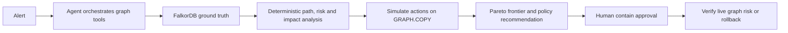

# NEXUS

**SYNTHETIC DATA** — NEXUS traces alert-linked identities through FalkorDB attack paths, simulates responses on disposable graph copies, and recommends a response under a visible risk-versus-disruption policy.

An alert can look small while the affected identity can reach critical data through several systems. The safest response is not always the action that removes the most risk: disabling a shared service account can interrupt production. NEXUS shows the paths and action trade-offs before a human approves containment.

## Demo

- Video: pending recording.
- Screenshots: pending capture from the running application.

## How it works



In real mode, the LLM orchestrates the investigation; FalkorDB provides the graph evidence, and deterministic analysis constrains the action. In scripted mode, the application calls the same tools in a fixed order without an LLM. Scripted mode proves engine behavior; it is not AI tool selection.

The attack graph uses Cytoscape.js's built-in CoSE force-directed physics layout. It animates into position, supports dragging nodes, and provides a **Re-run physics** control. See the [Cytoscape.js layout docs](https://js.cytoscape.org/index.html).

## FalkorDB graph model

The deterministic seed creates synthetic `Person`, `Device`, `Server`, `ServiceAccount`, `Service`, `DataStore`, `Vulnerability`, `IPAddress`, and `Alert` nodes. Typed relationships model ownership, logins, access, credentials, authentication, reads, dependencies, usage, and alert attribution. Cypher traverses up to seven hops to critical data stores and filters inactive nodes and edges. `GRAPH.COPY` creates disposable what-if graphs; executed containment writes status fields rather than deleting graph entities.

## Scoring and policy

- Risk: noisy-OR combination of path exploitability, target criticality and maximum privilege, scaled as `round(100 * (1 - exp(-sum(terms) / 4.0)))`. `K=4.0` follows the supplied spec's Part B precedence.
- Business impact: weighted dependent services and affected people, normalized by the supplied capacity constant.
- Pareto: an action is dominated when another action has no greater residual risk and no greater impact, with at least one strict improvement.
- Policy: risk below 25 selects monitor-only. Otherwise, the policy selects the lowest-impact Pareto action with residual risk at most 40; ties use lower residual risk. If none meets 40, it chooses the lowest residual risk and requires approval. HIGH/CRITICAL impact always requires human approval.

## Scenarios

| Alert | Starting risk | Recommendation |
|---|---:|---|
| ALT-1042 | 80 CRITICAL | Isolate `LAPTOP-042` |
| ALT-2071 | 68 HIGH | Disable `SVC-ACCT-17` |
| ALT-3310 | 0 LOW | Monitor only |

## Run locally

Requirements: Docker Desktop with Linux containers. From this directory:

```powershell
Copy-Item .env.example .env
docker compose up --build
```

Open [http://localhost:8080](http://localhost:8080). Compose starts FalkorDB and the NEXUS app, then seeds the synthetic graph on application startup. The default `.env.example` setting is `MOCK_LLM=1`, which runs the fixed scripted workflow and does not need an API key. For real LLM tool selection, set `MOCK_LLM=0` and supply `ANTHROPIC_API_KEY` in `.env`. The agent always calls execute tools with `approved=False`; the human-facing CONTAIN endpoint is the approval action.

The local development setup can also use the project `.venv`: start FalkorDB on port 6379, then run `python -m seed.generate`, `uvicorn api.main:app --port 8000`.

## Tests and benchmark

Run the automated scenario and API checks against the synthetic demo database:

```powershell
.\.venv\Scripts\python.exe -m pytest -q
```

Run the benchmark with `python -m bench.run_benchmark`. It records whether deterministic execution matched simulated residual risk. When a real API key is configured and `MOCK_LLM=0`, it also records whether the LLM-selected action agrees with the deterministic policy. Agreement measures consistency with this policy on synthetic data, not real-world correctness. Benchmark results are generated evidence in `bench/results.md`; do not present unrun or mock results as real-agent performance.

Current measured local run: **30 of 30** deterministic executions matched the simulated residual risk. No real LLM agreement result is reported because no Anthropic key was configured; all 30 were engine-only synthetic alerts.

## MCP server

Run `python -m mcp_server.server` from the project root. It exposes the same eight deterministic tools for compatible MCP clients. The built-in agent calls those functions directly.

## Limitations

All graph data is synthetic and results are not production-calibrated. Risk uses assumptions `K=4.0`, `IP_FACTOR=0.6`, and `REVOKE_FACTOR=0.7`; these are model constants, not validated probabilities. Choke points use attack-path coverage, not betweenness. Vulnerability nodes are seeded as evidence, but the supplied Part B risk code does not adjust scores based on vulnerability relationships. NEXUS describes next-move risk analysis, not attacker prediction. No latency or real-world effectiveness claim is made.

## AI assistance and track

Built for Graph Hacks Track 1, Graph Hacks. AI coding assistance was used to implement and review this project; contributors must understand and verify the submitted code.

## What comes next

- Record the real-agent demo and capture the decision card and containment matrix.
- Run and publish the benchmark with the mode and alert count clearly stated.
- Test a fresh clone and document any misses or dependency constraints.
