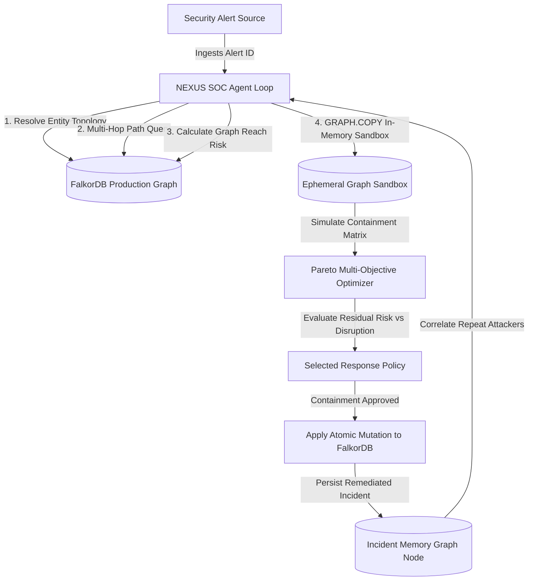

# FalkorDB Graph Architecture & SOC Verification Guide

> **Project NEXUS**: Autonomous Attack-Path SOC Investigation & Containment Engine  
> **Underlying Graph Engine**: [FalkorDB](https://www.falkordb.com/) (Redis-based Graph Database running OpenCypher)  
> **Engine Response Latency**: Sub-millisecond graph traversals (`0.4ms – 2.1ms`)

---

## 1. Executive Architecture Overview

Project NEXUS utilizes **FalkorDB** as the high-speed graph database driving autonomous SOC investigations. Unlike legacy relational or vector stores, FalkorDB enables:
1. **Multi-Hop Attack Path Traversal**: Traversing transitive trust relationships, lateral movement chains, and identity hops from entry-point alerts to high-value Crown Jewels (`DataStore` nodes).
2. **In-Memory What-If Sandboxing (`GRAPH.COPY`)**: Simulating candidate containment policies in ephemeral graph clones without mutating live production topology.
3. **Persistent Incident Memory**: Storing contained incidents and historical remediation outcomes as first-class graph entities (`Incident` nodes), enabling subsequent investigations to correlate repeat intrusion attempts and escalate response policies.
4. **Deterministic Graph Risk Scoring**: Evaluating blast radius and reachability factors ($C \times P \times R$) with sub-millisecond Cypher query execution.



---

## 2. FalkorDB Graph Schema

The NEXUS graph model represents an enterprise hybrid cloud environment with identities, devices, jumpboxes, services, vulnerabilities, and crown-jewel datastores.

### Node Labels
| Label | Description | Example IDs / Properties |
| :--- | :--- | :--- |
| `Person` | Employee or identity principal | `U-ALEX` (Alex Vance, DevOps), `U-PRIYA` (Priya Patel, Staff Eng) |
| `Device` | Physical workstation or laptop | `LAPTOP-042`, `LAPTOP-PRIYA` |
| `Server` | Compute host, jumpbox, or VM | `DEV-SERVER-03`, `DEV-SERVER-07`, `JUMPBOX-01` |
| `ServiceAccount` | Automated workload identity | `SVC-ACCT-09`, `SVC-ACCT-17` |
| `Service` | Running application daemon or microservice | `PROD-API`, `PAYMENTS-SVC`, `BILLING-SVC` |
| `DataStore` | High-value Crown Jewel asset (criticality 0.9–1.0) | `DB-PROD-01`, `CUSTOMER-DB`, `BILLING-DB` |
| `IPAddress` | Originating network IP entity | `IP-203-0-113-77`, `IP-203-0-113-99` |
| `Alert` | Security telemetry signal triggering investigation | `ALT-1042`, `ALT-1043`, `ALT-2071`, `ALT-3310` |
| `Incident` | **Persistent incident memory node** tracking containment | `id`, `alert_id`, `action`, `target`, `timestamp`, `status: 'CONTAINED'` |

### Edge Relationships
| Edge Type | Source Label | Target Label | Semantics |
| :--- | :--- | :--- | :--- |
| `OWNS` | `Person` | `Device` | Identity owns physical workstation |
| `LOGS_INTO` | `Device` | `Server` | Interactive remote SSH / RDP session |
| `AUTHENTICATES_TO` | `Person` / `Device` | `Server` / `Service` | Active session or credential exchange |
| `USED_BY` | `ServiceAccount` | `Service` | Service executes with account privileges |
| `HAS_ACCESS_TO` | `Person` / `ServiceAccount` | `DataStore` | Direct database permission |
| `READS_FROM` / `WRITES_TO` | `Service` | `DataStore` | Data flow connection to Crown Jewel |
| `CONTAINED_ENTITY` | `Incident` | Any entity | Incident record tracking quarantined entity |
| `ABOUT` | `Alert` | Any entity | Subject entity under investigation |

---

## 3. Core OpenCypher Queries in NEXUS

### A. Multi-Hop Attack Path Traversal
Traverses all bounded paths (up to 5 hops) from the compromised subject to any high-criticality `DataStore` (Crown Jewel):
```cypher
MATCH path = (start {id: $start_id})-[:OWNS|LOGS_INTO|AUTHENTICATES_TO|USED_BY|READS_FROM|WRITES_TO*1..5]->(target:DataStore)
WHERE coalesce(start.status, 'ACTIVE') = 'ACTIVE'
  AND ALL(n IN nodes(path) WHERE coalesce(n.status, 'ACTIVE') = 'ACTIVE')
RETURN [n IN nodes(path) | n.id] AS ids,
       [r IN relationships(path) | type(r)] AS types,
       length(path) AS length
ORDER BY length ASC
LIMIT 10
```

### B. Choke Point Detection
Finds intermediate bridge nodes that appear across 100% of attack paths, identifying the single point of failure where a minimal containment action severs all lateral routes:
```cypher
MATCH path = (start {id: $start_id})-[:OWNS|LOGS_INTO|AUTHENTICATES_TO|USED_BY|READS_FROM|WRITES_TO*1..5]->(target:DataStore)
WITH nodes(path) AS ns
UNWIND ns[1..-1] AS bridge
RETURN bridge.id AS choke_point, count(*) AS paths_blocked
ORDER BY paths_blocked DESC
LIMIT 1
```

### C. Persistent Incident Memory & Repeat-Attacker Correlation
Queries FalkorDB for active `CONTAINED` incident records linked to the subject or connected infrastructure:
```cypher
MATCH (inc:Incident)
WHERE inc.status = 'CONTAINED'
OPTIONAL MATCH (inc)-[:CONTAINED_ENTITY]->(t)
OPTIONAL MATCH (s)-[:OWNS|LOGS_INTO|AUTHENTICATES_TO*1..2]-(t)
WHERE t.id = $id OR t.owner_id = $id OR inc.target = $id OR s.id = $id
RETURN inc.id AS incident_id, inc.alert_id AS alert_id, inc.action AS action,
       coalesce(t.id, inc.target) AS target, inc.timestamp AS timestamp
LIMIT 1
```

### D. Writing Contained Incident Memory to FalkorDB
When containment is approved, NEXUS writes an `Incident` node and links it to the quarantined target:
```cypher
MERGE (inc:Incident {id: $inv_id})
SET inc.alert_id = $alert_id,
    inc.action = $action,
    inc.target = $target,
    inc.timestamp = timestamp(),
    inc.status = 'CONTAINED'
WITH inc
MATCH (t {id: $target})
MERGE (inc)-[:CONTAINED_ENTITY]->(t)
```

---

## 4. Deterministic Risk Scoring Formula

NEXUS computes risk deterministically over the active graph topology using:
$$\text{Score} = \min\left(100, \text{round}\left(\sum_{\text{store} \in \text{CrownJewels}} C(\text{store}) \times P(\text{path}) \times R(\text{path}) \times 100\right)\right)$$

Where:
- $C(\text{store})$ = DataStore Criticality factor ($0.9$ to $1.0$ for Crown Jewels).
- $P(\text{path})$ = Privilege factor along the route ($0.9$ for Domain / DB admin access).
- $R(\text{path})$ = Path Reachability factor ($0.9$ when active routes exist; drops to $0.0$ when severed).

---

## 5. Judge Quickstart: Testing FalkorDB Scenarios

### Step 1: Start Container Stack
```bash
docker compose up -d
# App running at http://localhost:8080
# FalkorDB running on redis port 6379
```

### Step 2: Test Persistent Memory Escalation (Scenario 1 & 2)
1. In the web UI at `http://localhost:8080`, select **`ALT-1042`** (`SUSPICIOUS_REMOTE_LOGIN` on `U-ALEX`).
2. Click **Run guided demo** (or **Investigate**).
   - Review 3 attack paths in the **Attack Paths Identified** stepper (`Route 1`, `Route 2`, `Route 3`).
   - Notice the identified Choke Point: `LAPTOP-042`.
   - Recommended Policy: `isolate_device LAPTOP-042`.
3. Click **APPROVE & APPLY CONTAINMENT**.
   - FalkorDB marks `LAPTOP-042` as `ISOLATED` and persists `(inc:Incident {status: 'CONTAINED', target: 'LAPTOP-042'})`.
4. Now select **`ALT-1043`** (`REPEAT_ACCESS_ATTEMPT` on `U-ALEX` from external IP `203.0.113.99`).
5. Click **Investigate**.
   - NEXUS queries FalkorDB incident memory and detects the prior containment on Alex's laptop.
   - The UI renders the glowing green **FalkorDB Persistent Incident Memory Active** card.
   - The response policy automatically **escalates** from device isolation to `quarantine_account U-ALEX` to prevent lateral re-compromise.

### Step 3: Test Benign Ego-Topology (Scenario 4)
1. Select **`ALT-3310`** (`LOGIN_NEW_DEVICE` on `U-PRIYA`).
2. Click **Investigate**.
   - 0 attack paths to Crown Jewels found; initial risk is **0/100**.
   - Cytoscape renders Priya's local baseline ego-network with the green banner: `🛡️ LOCAL EGO-TOPOLOGY · BENIGN BASELINE`.
   - Recommended response: `MONITOR ONLY`.
